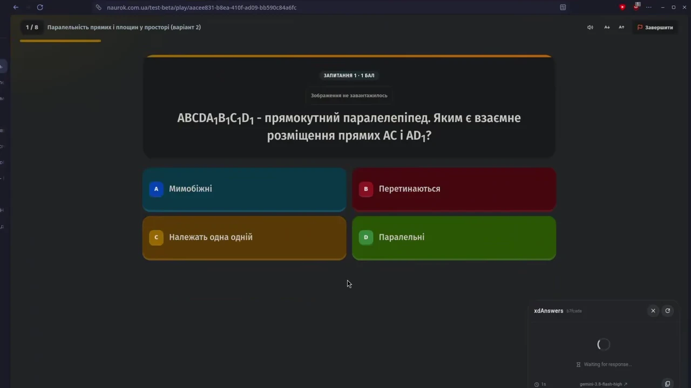

## xdAnswers
*[Licensed under the GNU General Public License v3.0](LICENSE)*

Безкоштовне розширення з відкритим кодом, яке розв'язує тестові питання за допомогою ШІ.


[](https://t.me/s/migor1103_donate)

> [!IMPORTANT]  
> Проект може мати баги. Будь ласка, [Звітуйте про них](https://github.com/aartzz/xdAnswers/issues).



### Можливості

- **Безкоштовні моделі з коробки** — DeepSeek, MiMo, Nemotron, Qwen etc.
- **Будь-який OpenAI-сумісний API** — OpenAI, Anthropic, Gemini, DeepSeek, Groq, локальний Ollama, що завгодно
- **Розпізнавання зображень** — обробляє зображення в питаннях та варіантах відповідей (через провайдери з підтримкою vision)
- **Пошук в інтернеті** — модель може самостійно шукати актуальну інформацію в мережі (пару безкоштовних інстанцій SearXNG інтегровано з коробки)
- **Тихі режими** — індикатори (точка біля правильної відповіді), заголовок сторінки, стелс (тільки буфер обміну) або one-click (клік на питання для відповіді)
- **Автовідповідь** — автоматично обирає правильний варіант із налаштовуваною затримкою (cooldown)
- **Консенсус** — запускає відповідь кількома моделями одночасно та обирає варіант більшості
- **Плаваючий помічник** — перетягуваний, показує відповідь + пояснення + витрачений час
- **Мультиязичність** — інтерфейс українською, російською та англійською
- **Кастомні теми** — обери готову або створи свою з + кнопкою
- **Disabler (обхід анти-читу)** — універсальний та специфічний для кожного сайту

### Встановлення

#### PC (Chromium-based browsers)

1. Перейдіть до [Releases](https://github.com/aartzz/xdAnswers/releases), завантажте останній `xdAnswers-chrome-*.zip`
2. Розпакуйте
3. Відкрийте `chrome://extensions`, увімкніть **Режим розробника** (справа вгорі)
4. Натисніть **Завантажити розпаковане розширення**, оберіть розпаковану папку

#### PC (Gecko-based browsers)

Розширення підписано Mozilla — працює на будь-якій версії Firefox без додаткових налаштувань.

1. Завантажте `xdAnswers-firefox-*.xpi` з [Releases](https://github.com/aartzz/xdAnswers/releases)
2. Перетягніть файл `.xpi` у вікно Firefox → підтвердіть встановлення

#### Android (Kiwi Browser)

1. Встановіть [Kiwi Browser](https://github.com/kiwibrowser/src.next/releases/tag/14310011181) з GitHub
2. Перейдіть до [Releases](https://github.com/aartzz/xdAnswers/releases), завантажте останній `xdAnswers-chrome-*.zip`
3. Відкрийте `kiwi://extensions`, увімкніть **Режим розробника**
4. Натисніть **Завантажити розпаковане розширення**, оберіть розпаковану папку

### Збірка з вихідного коду

Потрібен [Node.js](https://nodejs.org/) 18+ (щоб був доступний `npm`).

```bash
git clone https://github.com/aartzz/xdAnswers.git
cd xdAnswers
npm install
```

Далі оберіть ціль:

```bash
# Firefox — готовий .xpi (не підписаний)
npm run build:firefox

# Chrome/Brave/Edge/Vivaldi — готовий .zip
npm run build:chrome
```

> [!NOTE]
> Для підписання Firefox-розширення потрібні облікові дані Mozilla Add-ons API. Створи файл `.env` у корені проєкту (дивись `.env.example`) або передай їх через змінні середовища `WEB_EXT_API_KEY` / `WEB_EXT_API_SECRET`, потім запусти `npm run sign:firefox` щоб скомпілювати підписаний .xpi.

Готові артефакти лежать у папці `./build`. Далі встановлюйте їх так само, як і реліз-файли (див. розділи вище).

> [!TIP]
> Скрипти `build:firefox` / `build:chrome` крос-платформні (працюють на Windows, macOS, Linux) — вони автоматично генерують правильний `manifest.json` для вибраного браузера, пакують розширення через `web-ext` і прибирають тимчасові файли.

Для ітеративної розробки зручно використовувати режим `web-ext run`, який запускає тимчасовий профіль браузера з уже завантаженим розширенням і автоматично перезавантажує його при змінах у файлах:

```bash
# Спочатку зберіть розширення у ./dist
npm run dev # або: node scripts/build.js firefox

# Firefox — відкриється тимчасовий Firefox з розширенням
npx web-ext run

# Chrome/Chromium (потребує встановленого Chrome)
npx web-ext run -t chromium
```

### Підтримувані сайти

| Сайт | URL | Статус | Авто-Відповідь | Disabler | Silent mode |
|------|-----|--------|:--------------:|:--------:|:-----------:|
| НаУрок | [naurok.com.ua](https://naurok.com.ua) | 🟢 | ✅ | ✅ | ✅ |
| Всеосвіта | [vseosvita.ua](https://vseosvita.ua) | 🟡 | ✅ | ✅ | ✅ |
| JustClass | [justclass.com.ua](https://justclass.com.ua) | 🟡 | ✅ | ⚠️ | ✅ |
| Kahoot! | [kahoot.it](https://kahoot.it) | ❔️ | ✅ | ✅ | ✅ |
| Classtime | [classtime.com](https://classtime.com) | ❔️ | ✅ | ⚠️ | ✅ |
| МійКлас | [miyklas.com.ua](https://miyklas.com.ua) | ❔️ | ✅ | ⚠️ | ✅ |
| LCloud | [lcloud.in.ua](https://lcloud.in.ua) | ❔️ | ⚠️ | ⚠️ | ✅ |
| Google Forms | [docs.google.com/forms](https://docs.google.com/forms) | 🟢 | ✅ | ➖ | ✅ |
| Microsoft Forms | [forms.office.com](https://forms.office.com) | 🟡 | ✅ | ➖ | ✅ |
| Quizlet | [quizlet.com](https://quizlet.com) | ❔️ | ⚠️ | ⚠️ | ✅ |
| Szkoła w Chmurze | [szkolawchmurze.org](https://szkolawchmurze.org) | ❔️ | ⚠️ | ⚠️ | ✅ |
| TestPortal | [testportal.pl](https://testportal.pl) | ❔️ | ⚠️ | ⚠️ | ✅ |

#### Умовні позначення
| Позначення | Пояснення |
|------------|-----------|
| ✅ | повністю підтримується |
| ⚠️ | використовується універсальне рішення або ще в розробці |
| ❌ | не підтримується |
| ➖ | не планується |
| 🟢 | роботу перевірено повністю |
| 🟡 | роботу перевірено не повністю |
| ❔️ | роботу не було перевірено |
